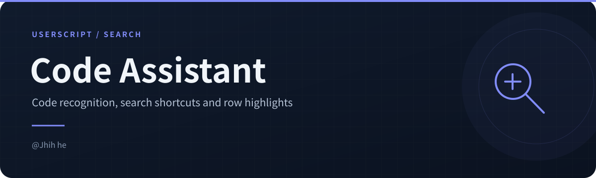
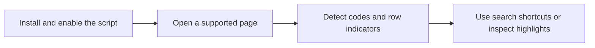

<!-- readme-visuals:header:start -->

  
  
  

<!-- readme-visuals:header:end -->

# 🚀 Code Assistant: Auto-recognize codes & One-click search ➕ HD & Chinese Subtitle Highlighter (UI/UX Pro Max)

> 💡 **Core Philosophy**: Making the search for high-quality resources simpler and more elegant than ever!

This is a Tampermonkey script dedicated to providing the **Ultimate Browsing Experience (UI/UX Pro Max)**. It intelligently scans codes (designations) on web pages, provides beautiful **One-click Search** capsule buttons, and automatically **Highlights** resource rows containing "HD" and "Chinese Subtitles", helping you lock onto the best resources in a second!

---

<!-- readme-visuals:overview:start -->

## At a glance

<table>
<tr>
<td width="33%"><strong>Code recognition</strong>  Scan page codes and add search shortcuts.</td>
<td width="33%"><strong>Row highlighting</strong>  Highlight rows with HD and Chinese subtitle indicators.</td>
<td width="33%"><strong>Dynamic pages</strong>  Observe new content and toggle highlights from the menu.</td>
</tr>
</table>

### Workflow overview

<!-- readme-visuals:overview:end -->

## ✨ Features

### 🔍 1. Smart Code Recognition & One-click Search
- **Precise Recognition**: Automatically scans web content to intelligently extract codes in formats like `SSIS-924`, `ssis-924`.
- **Capsule Button**: Automatically adds a modern "🔍 Search XXX" capsule button next to the code.
- **Safety**: Smartly avoids special tags like `SCRIPT`, `STYLE`, `CODE`, and inside links, **absolutely not breaking the original page structure**.
- **Dynamic Loading Support**: Uses `MutationObserver` technology, perfectly compatible with waterfall flow, infinite scrolling, and other dynamic loading pages.

### 🌟 2. HD & Chinese Subtitle Exclusive Highlight
- **Visual Guidance**: Automatically scans table rows (`<tr>`), and when it detects both "**HD**" and "**Chinese/Chinese Subtitles**", it highlights the row with a conspicuous amber color (`#ffecb3`).
- **Immersive Interaction**: Highlighted rows come with a left indicator strip and mouse hover effects, making high-quality resources stand out in the vast list.

### 🎨 3. UI/UX Pro Max Experience
- **Modern Design**: Abandoning traditional ugly buttons, adopting a carefully tuned "Pale Blue Background + Brand Blue Text" capsule design.
- **Smooth Transitions**: Added animation effects for button hover floating and shadow changes, providing excellent click feedback.
- **Menu Control**: Supports one-click toggle of the highlight feature via the Tampermonkey extension menu, taking effect immediately.

---

## 🛠️ Installation & Usage

1. **Environment**: Ensure your browser has [Tampermonkey](https://www.tampermonkey.net/) or a similar user script manager installed.
2. **Install Script**: Click the "Install this script" button on this page.
3. **Start Using**: No configuration needed. Open any resource website (such as various Magnet sites, Torrent sites, Sukebei, forums, etc.), and the script will silently serve you in the background!

---

## 📝 Changelog

- **v2.0 (Current)**
  - 🚀 Comprehensively upgraded name and description, added multi-language support, going international.
  - 🎨 UI/UX experience further optimized, button interaction smoother.
  - 🔍 Added search engine spider-friendly SEO keywords.
- **v1.9**
  - ✨ Enhanced version released, optimized DOM parsing logic, does not break original links.

---
*❤️ If you find it useful, please give a good review on GreasyFork to support! Your support is my biggest motivation for updates!*
